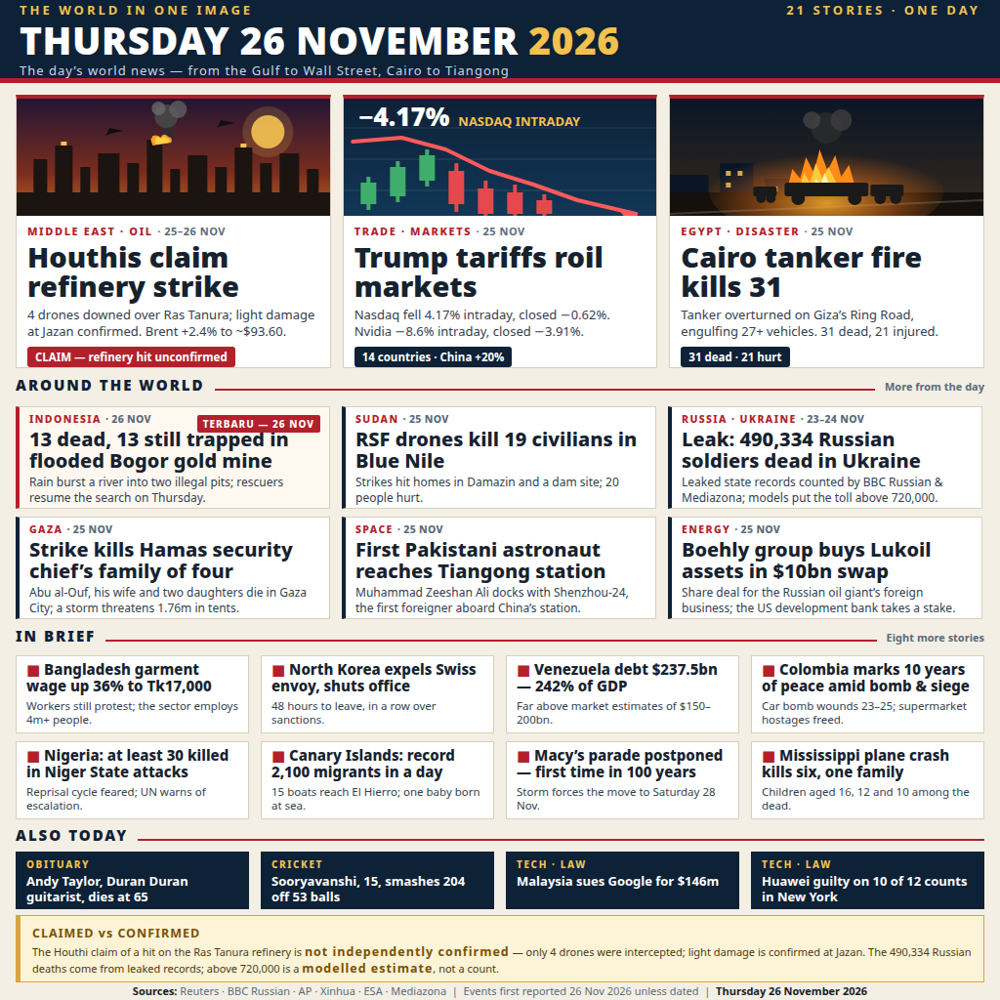

[](https://make.fun/c/news-image-20261126)
[](https://make.fun/c/news-image-20261126)
[](https://make.fun/c/news-image-20261126)

# The World in One Image — Thursday 26 November 2026

One image that sums up the world's news of Thursday 26 November 2026, built
for the [make.fun news-image-20261126 competition](https://make.fun/c/news-image-20261126).



## What's in the picture

21 stories from a single day, across regions and beats:

- **3 lead stories** — the Houthis' claimed strike on Saudi Arabia's Ras Tanura
  refinery (labelled a claim, not confirmed), Trump's tariffs on 14 trading
  partners and the market sell-off (intraday and closing moves shown
  separately), and the Cairo fuel-tanker fire that killed 31.
- **Around the world (6)** — led by the freshest story of the day, the flooded
  illegal gold mine in Bogor (13 dead, 13 still trapped), plus Sudan, the
  leaked Russian death toll, Gaza, the first Pakistani astronaut on Tiangong,
  and the Lukoil sale.
- **In brief (8)** — Bangladesh, North Korea, Venezuela, Colombia, Nigeria,
  the Canary Islands, the postponed Macy's parade, and the Mississippi crash.
- **Also today (4)** — Andy Taylor, Vaibhav Sooryavanshi, Malaysia vs Google,
  and the Huawei verdict.
- A **"Claimed vs Confirmed"** box keeps unconfirmed claims and modelled
  estimates visibly separate from confirmed facts.

## How the entry works

`entry.png` (1024×1024, rendered from an HTML/CSS newspaper layout) is shipped
in this repository. `main.ts` (Node 22, standard library only, no network)
validates the PNG — signature, IHDR dimensions, and a full chunk walk with
CRC-32 checks — then copies it byte-for-byte to `$MAKEFUN_OUTPUT_DIR/entry.png`
(default `/output`).

```sh
mkdir -p out && MAKEFUN_OUTPUT_DIR=out node main.ts
```

## Sources

Reuters, BBC Russian, AP, Xinhua, ESA, Mediazona. Events first reported
26 November 2026 unless dated on the image.

## License

MIT — see [LICENSE](LICENSE).
